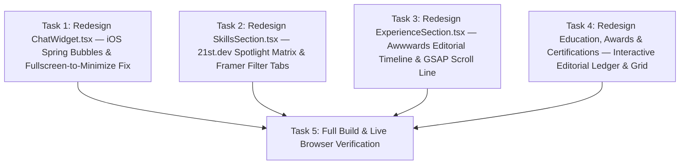

# Implementation Plan: 2026 Awwwards / 21st.dev / Framer Redesign (Lower Sections & AI ChatWidget)

## Design Read (`/skill:design-taste-frontend` & `/skill:hallmark`)
> **Reading this as:** Developer portfolio for hiring managers & clients, with a **2026 Minimalist Editorial & Kinetic Awwwards / 21st.dev / Framer** language (`Plus Jakarta Sans` + `Playfair Display` + `JetBrains Mono`, high-contrast Zinc/Slate neutrals + singular `#ed5d31` vibrant orange accent, GSAP `ScrollTrigger` scroll choreography + Framer Motion spring physics).
> **Dials:** `DESIGN_VARIANCE: 8` · `MOTION_INTENSITY: 7` · `VISUAL_DENSITY: 4`

---

## Overview
Menyelaraskan desain bagian bawah halaman utama (**03. Teknologi yang Saya Gunakan / `SkillsSection`** hingga **07. Sertifikasi Profesional / `CertificationsSection`**) agar menyatu sempurna dengan estetika **Modern 2026 Awwwards / 21st.dev / Framer** yang sudah ada pada bagian atas halaman (`ProfileHeader`, `AboutSection`, `PortfolioSection`), sekaligus merombak total **`ChatWidget.tsx`** dengan animasi bubble sehalus iOS (spring physics dari sudut ekor bubble), tampilan panel modern 2026, serta memperbaiki bug kritis saat berpindah dari mode **Fullscreen ke Minimize**.

---

## Root Cause Analysis: Mengapa Bagian Bawah Terlihat Kaku & Berbeda?
1. **Ketidakkonsistenan Tipografi & Header Seksi**:
   - Bagian atas (`AboutSection`, `PortfolioSection`) menggunakan nomor seksi `JetBrains Mono` berwarna aksen (`01.`, `02.`) yang dipadukan dengan judul besar `Playfair Display` (`clamp(2rem, 4vw, 3rem)`).
   - Sebaliknya, `SkillsSection` s/d `CertificationsSection` tiba-tiba menggunakan heading kecil `1.5rem` sans-serif dengan garis horizontal biasa dan memanggil `var(--font-inter)` yang tidak didefinisikan.
2. **Kurangnya Kinetika On-Scroll (`GSAP ScrollTrigger`)**:
   - Bagian atas memiliki animasi scroll aktif (word-by-word scrub di `AboutSection` dan horizontal coverflow di `PortfolioSection`), sedangkan bagian bawah hanya menampilkan kotak-kotak statis `border-radius: 12px` yang menumpuk vertikal.
3. **Bug Fullscreen → Minimize pada `ChatWidget.tsx`**:
   - Tombol Minimize hanya memanggil `setIsMinimized((v) => !v)` tanpa mereset `setIsFullscreen(false)`.
   - Di dalam `getPanelStyle()`, kondisi `if (isFullscreen)` dievaluasi **sebelum** `if (isMinimized)`. Akibatnya, saat pengguna menekan Minimize dari mode Fullscreen, panel tetap berukuran `100% x 100%` menutupi seluruh layar sementara isi chat disembunyikan oleh `{!isMinimized && ...}`.

---

## Architecture & Component Design Decisions

1. **`ChatWidget.tsx` (iOS-Smooth Bubbles + 21st.dev Floating Chrome + State Bug Fix)**:
   - **State Fix**: Saat tombol Minimize diklik ketika `isFullscreen === true`, otomatis menonaktifkan `isFullscreen` (`setIsFullscreen(false)`) dan mengubah panel menjadi *Minimized Floating Pill* di kanan bawah. Kondisi `if (isMinimized)` diprioritaskan di atas `if (isFullscreen)`.
   - **iOS Spring Message Bubbles**: Menggunakan `motion.div` dengan `layout="position"`, `transformOrigin` di sudut ekor bubble (`bottom right` untuk user, `bottom left` untuk AI), serta pegas `stiffness: 520, damping: 34, mass: 0.7` sehingga bubble muncul dan membesar sehalus iMessage di iOS saat mengirim maupun menerima stream jawaban.
   - **2026 Modern UI**: Header kaca editorial dengan indikator status aktif, tombol *Reset Conversation*, chip saran pertanyaan bergaya kapsul interaktif, serta input dock modern dengan tombol kirim beranimasi pegas.
2. **`SkillsSection.tsx` ("03. Teknologi yang Saya Gunakan")**:
   - Header editorial (`03.` mono accent + `Playfair Display` `clamp(2rem, 4vw, 3rem)`).
   - Filter tab kategori interaktif dengan indikator geser `layoutId` Framer Motion (`Semua` + per kategori).
   - Kartu arsitektural bernomor indeks (`/01`, `/02`) dengan efek **21st.dev Cursor Spotlight** dan node teknologi interaktif yang muncul bertahap saat di-scroll menggunakan **GSAP `ScrollTrigger`**.
3. **`ExperienceSection.tsx` ("04. Pengalaman Kerja / Organisasi / Kepanitiaan")**:
   - Header editorial besar dengan penghitung jumlah peran.
   - **GSAP `ScrollTrigger` Progress Line** vertikal di sisi kiri yang terisi warna `var(--accent)` seiring scroll halaman.
   - Baris pengalaman bergaya **Awwwards Interactive Ledger** dengan indeks `01`, `02`, badge periode `JetBrains Mono`, efek hover garis aksen, dan akordeon detail poin beranimasi pegas halus.
4. **`EducationSection.tsx`, `AwardsSection.tsx`, `CertificationsSection.tsx` ("05." s/d "07.")**:
   - **`EducationSection`**: Layout split editorial dengan watermark indeks besar, tipografi institusi `Playfair Display`, dan blok callout skor/IPK beraksen kontras tinggi.
   - **`AwardsSection`**: Daftar interaktif bergaya **Awwwards Hover Table/Ledger** dengan animasi geser judul saat hover, badge tahun `JetBrains Mono`, dan ikon trofi yang menyala.
   - **`CertificationsSection`**: Grid **21st.dev Credential Showcase** dengan header metadata (`ISSUER` & `DATE`), judul sertifikasi editorial, indikator masa berlaku, dan tombol magnetik `"Verify Credential ↗"`.

---

## Task List

### Phase 1: AI Assistant Redesign & Bug Fix
- [ ] **Task 1**: Redesign `ChatWidget.tsx` (Perbaikan bug Fullscreen-to-Minimize, animasi bubble iOS spring, dan desain panel 2026)

### Phase 2: Lower Sections Awwwards / 21st.dev / Framer Redesign
- [ ] **Task 2**: Redesign `SkillsSection.tsx` (Editorial Header, Framer `layoutId` Category Filter, 21st.dev Spotlight Cards & GSAP ScrollTrigger)
- [ ] **Task 3**: Redesign `ExperienceSection.tsx` (GSAP Scroll-Driven Timeline Line, Awwwards Interactive Ledger Rows & Spring Accordion)
- [ ] **Task 4**: Redesign `EducationSection.tsx`, `AwardsSection.tsx`, dan `CertificationsSection.tsx` (Editorial Split Cards, Awwwards Hover Ledger, Credential Showcase Grid & GSAP ScrollTrigger)

### Phase 3: Verification
- [ ] **Task 5**: Verifikasi TypeScript (`tsc --noEmit`), Production Build (`npm run build`), dan Live Browser Inspection (uji buka chat → fullscreen → minimize → restore → kirim pesan, serta scroll animasi seksi 03–07)

---

## Risks and Mitigations
| Risk | Impact | Mitigation |
|------|--------|------------|
| Bug layout Framer Motion saat transisi dari `isFullscreen` ke `isMinimized` | High | Reset `isFullscreen` menjadi `false` saat minimize ditekan dan prioritaskan `if (isMinimized)` pada `getPanelStyle()`. |
| Konflik `ScrollTrigger` antara seksi atas dan seksi bawah | Medium | Gunakan `gsap.context` / `useGSAP` dengan `scope` lokal di masing-masing komponen seksi sehingga trigger terisolasi. |
| Kontras warna di mode Light vs Dark | Medium | Gunakan seluruhnya token CSS di `:root` / `html.light` (`var(--bg-primary)`, `var(--bg-secondary)`, `var(--text-primary)`, `var(--accent)`). |
